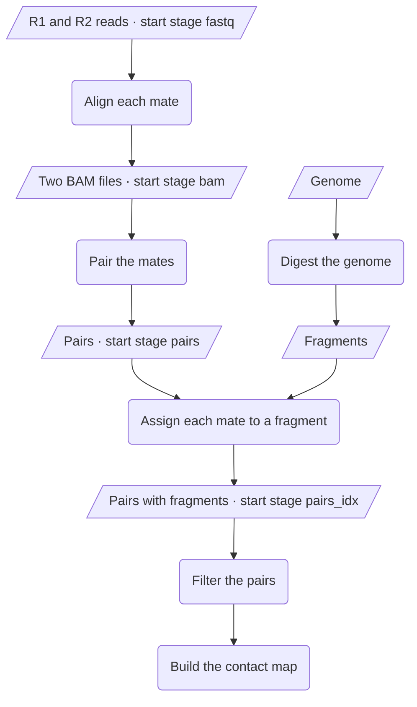

# Concepts

This page explains what hicstuff does with the reads, and the words the rest
of the documentation uses for it: fragments, bins, pairs and 3C events. For
the layout of each file, see [File formats](formats.md).

## From reads to contacts

A Hi-C library is made by cutting cross-linked chromatin with a restriction
enzyme (or MNase, or DNase), ligating the ends that lie close in space, and
sequencing the junctions in pairs. Each read pair has two **mates**, R1 and R2,
which come from either side of a ligation junction. The more often two loci are
found in the same pair, the closer they tended to lie in the nucleus.

hicstuff aligns the two mates separately, as single-end reads, then pairs them
again by read name. The recommended way, mapping mode `5spm`, aligns them with
`bwa mem -5SPM`, as the 4DN, Juicer and Arima pipelines do (see
[Aligning reads](guides/alignment.md#5spm)). A pair whose two mates aligned with a mapping quality of at
least `--quality-min` (30 by default) is a **contact**. The contacts are
counted between genomic intervals to make the **contact map**.

## The pipeline

`hicstuff pipeline` runs these steps (rounded) in order, and writes the files
(slanted) between them. `--start-stage` starts it from one of those files
instead of from the reads:

[Running the pipeline](guides/pipeline.md) lists the files of each step.

## Fragments and bins

The rows and columns of a contact map are genomic intervals. hicstuff has two
kinds.

**Fragments** are what the genome is cut into before the reads are counted:

- With a restriction enzyme (`--enzyme DpnII`), the genome is digested in
  silico at every site of the enzyme, and the fragments are the restriction
  fragments the experiment made. Several enzymes cut together
  (`--enzyme DpnII,HinfI`). Any enzyme of Biopython's
  [Restriction](https://biopython.org/docs/latest/api/Bio.Restriction.html)
  module can be named.
- With a number (`--enzyme 5000`, the default), the genome is cut into chunks
  of that many base pairs, at least 50. For libraries that no restriction
  enzyme made, `hicstuff pipeline --enzyme mnase` (or `dnase`) cuts it into
  100 bp chunks.

Every mate is assigned to the fragment it falls in, and the map hicstuff writes
first has one bin per fragment. At restriction-fragment resolution, the bins
vary in size, as [instaGRAAL](https://github.com/koszullab/instaGRAAL) needs
them.

**Bins** of a fixed size come with `--binning`: `--binning 1000` counts the
contacts in 1 kb bins, whatever the fragments. The pipeline then writes a
`.mcool` file at 1, 2, 5, 10, 20, 50 and 100 times that size, balanced at each
of them. `hicstuff rebin` and `hicstuff view --binning` bin an existing map,
either by merging a number of bins (`--binning 10`) or to a size in base pairs
(`--binning 10kb`).

## Pairs

Contacts are kept, between steps, in the
[pairs format](https://github.com/4dn-dcic/pairix/blob/master/pairs_format_specification.md)
of the 4D Nucleome consortium: one line per contact, with the read name, then
the chromosome, position and strand of each mate. Once each mate has been
assigned to a fragment, two columns are added, `frag1` and `frag2`.

Positions are 1-based. In mapping mode `5spm` they are the aligned 5' end of
each mate, the end of the sequenced molecule, as pairtools records them. In
the other modes they are the leftmost base of each mate's alignment: its 5' end
on the forward strand, but its 3' end on the reverse strand.

## 3C events

Not every pair is a contact between two loci. Some fragments were never cut,
or never ligated to another one; their mates still map close to each other, and
add signal that reflects the protocol rather than the chromosome's folding.

hicstuff tells them apart by the strands of the two mates of a pair on the same
chromosome, the leftmost mate first:

| Strands | Event | How the pair arose |
|---|---|---|
| `+-` | **uncut** | The mates face each other, as on an undigested fragment, or one ligated back in place. |
| `-+` | **loop** | The mates face away from each other, as on a fragment that ligated to itself, closing a circle. |
| `++`, `--` | **weird** | Both mates on the same strand: only a real ligation between two fragments gives this. |

Pairs on different chromosomes are **inter**-chromosomal. Far from each other,
the four orientations are equally likely. Near each other, the uncuts and
loops add to the `+-` and `-+` pairs. `--filter` removes the `+-` and `-+`
pairs whose mates lie at most a few restriction sites apart: up to the shortest
distance at which each kind is no more frequent than the other orientations.
It also removes the `++` and `--` pairs with both mates on one fragment, which
no ligation can give. The two thresholds are estimated from the library; see
[Filtering 3C events](guides/filter.md).

**PCR duplicates** are pairs with the same coordinates, strands and fragments
for both mates. `--duplicates` keeps one of each.

## Contact map formats

| Format | `--matrix` | Files | Read by |
|---|---|---|---|
| cool (default, below 50,000 contigs) | `cool` | `.cool`, or `.mcool` with `--binning` | cooler, cooltools, HiGlass, … |
| metacool (default from 50,000 contigs) | `metacool` | `.metacool`, one bin per fragment | metacooler, cooler, … |
| 2D bedgraph | `bg2` | `.bg2` | `cooler load -f bg2` |
| graal | `graal` | a sparse matrix, `fragments_list.txt`, `info_contigs.txt` | instaGRAAL |
| none | `none` | no map: the run ends with its pairs file | metaTOR, metacooler, … |

Every command that reads a map (`view`, `rebin`, `subsample`, `convert`,
`scalogram`) takes cool, 2D bedgraph and graal maps, and tells them apart by
the file: a `.cool` name or a `.mcool::/resolutions/<N>` URI is a cool, a
first line of seven tab-separated fields a 2D bedgraph, of three fields a graal
matrix. A graal matrix carries no coordinates: the commands that need them take
its `fragments_list.txt` with `--frags`, and `rebin` its `info_contigs.txt`
with `--chroms` as well. They do not read a `.metacool` file, which metacooler
reads, and cooler too, as a cool file.

## Coordinates

| Where | Convention |
|---|---|
| Pairs files (`pos1`, `pos2`) | 1-based |
| `fragments_list.txt` (`start_pos`, `end_pos`) | 0-based, end excluded: a fragment from 0 to 21 holds bases 1 to 21 |
| `fragments_list.txt` (`id`) | 1-based, counted again from 1 on each contig |
| Pairs files (`frag1`, `frag2`) and graal matrices | 0-based, counted across the genome: the row of the fragment in `fragments_list.txt` |
